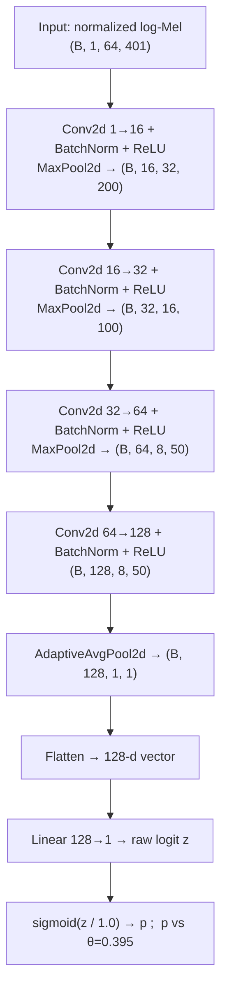
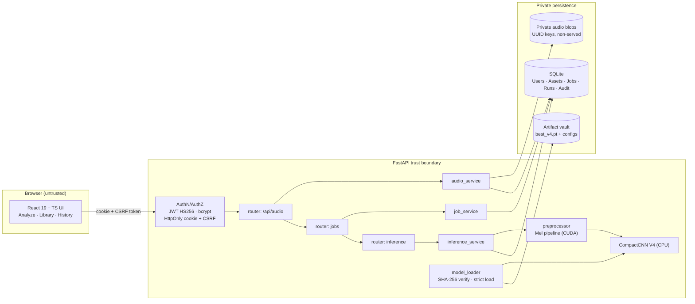

# 🛡️ SpeechShield
### A Deep Learning–Based Synthetic Speech Detection System — From Frozen Model to Controlled Full-Stack Application


> **The 3-minute gist**
> SpeechShield answers one question: *is this recording genuine human speech, or AI-generated / manipulated speech?*
> It is a **binary classifier** (0 = BONAFIDE, 1 = SPOOF) built on a frozen **97,761-parameter CompactCNN (V4)** that reads a normalized **64×401 log-Mel spectrogram**, wrapped in a **secure FastAPI + React application**.
> What makes it unusual is the **engineering discipline around the model**: speaker-independent training splits, multi-generator synthetic data, SHA-256-verified frozen checkpoints, **numerical parity validation** proving the app reproduces training-time preprocessing exactly, strict job/run state machines, ownership-enforced private audio storage, and an openly documented **real-world domain-shift limitation**.
> **Read §1–§2 for the working principle, §3 for architecture, §4–§5 for data & evidence, §8 for the map into the code.**

---

## Table of Contents
1. [Problem & Scope](#1-problem--scope)
2. [Working Principle](#2-working-principle)
3. [System Architecture & Data Model](#3-system-architecture--data-model)
4. [Datasets](#4-datasets)
5. [Model Card: Configuration, Metrics, Parity, Domain Shift](#5-model-card)
6. [Technology Stack](#6-technology-stack)
7. [Security Model](#7-security-model)
8. [Repository Layout & "Question → Code File" Map](#8-repository-layout--code-map)
9. [Quickstart](#9-quickstart)
10. [Testing & CI](#10-testing--ci)
11. [Development History](#11-development-history)
12. [Limitations & Honest Boundaries](#12-limitations--honest-boundaries)
13. [Misconception Checklist](#13-misconception-checklist)
14. [License & Contact](#14-license--contact)

---

## 1. Problem & Scope

Neural TTS and voice-conversion systems now produce speech that humans cannot reliably distinguish from real recordings, enabling impersonation, fraudulent voice messages, fabricated audio evidence and social-engineering attacks.

SpeechShield formulates detection as supervised binary classification over acoustic representations:

| Class | Label | Meaning |
|---|---|---|
| 0 | `BONAFIDE` | Genuine human speech |
| 1 | `SPOOF` | Synthetic (TTS) or converted (VC) speech |

**What SpeechShield IS:** a reproducible detector + a controlled application pipeline with verified preprocessing parity, checkpoint integrity, authorization gates and regression tests.
**What SpeechShield IS NOT:** a speaker-identification tool, a calibrated probability estimator, or a production-approved forensic authority.

---

## 2. Working Principle

### 2.1 The audio signal chain

Every recording — during training *and* inside the application — travels through this exact chain. The application's job is to reproduce it bit-faithfully:

```text
 File bytes (WAV / FLAC)
        │  decode (soundfile)
        ▼
 PCM  ·  sr ∈ [8 kHz … 96 kHz]  ·  ≤ 2 channels
        │  mono mixdown → resample to 16 000 Hz
        ▼
 Waveform @ 16 kHz
        │  centre pad / trim → exactly 64 000 samples (4.000 s)
        ▼
 Standardized waveform
        │  Mel filterbank: n_fft = 512 · hop = 160 · n_mels = 64
        ▼
 Mel spectrogram  (64 × 401)
        │  log(·)
        ▼
 Log-Mel  (64 × 401)
        │  per-recording normalization (μ, σ)
        ▼
 Normalized FP32 features
        │  FP16 cache round-trip  ← training-parity requirement
        ▼
 Model input tensor  (1, 1, 64, 401)
        │  CompactCNN V4  (97 761 params, frozen)
        ▼
 Raw logit z
        │  p = sigmoid(z / T),  T = 1.0
        ▼
 Spoof probability p
        │  p ≥ θ (θ = 0.395) ?
        ├── yes ──▶  CLASS 1 · SPOOF
        └── no  ──▶  CLASS 0 · BONAFIDE
```

### 2.2 The neural network



Convolutions learn local time–frequency artefact patterns; pooling compresses the map; adaptive pooling makes the classifier length-independent; the single linear head emits the logit. The network is deliberately compact: Mel extraction runs on CUDA, CNN inference on CPU.

### 2.3 The ten-step working principle
1. A user uploads WAV/FLAC over an authenticated, CSRF-protected channel.
2. The backend validates format, size, duration, sample rate and channels **before** storing anything.
3. The file is written to **private storage** under a UUID; metadata + SHA-256 are persisted.
4. A processing **job** is created and moves through an explicit state machine.
5. An **authorization gate** decides whether inference may run at all (otherwise HTTP 423 — no fabricated prediction).
6. The recording is decoded and pushed through the signal chain of §2.1.
7. The frozen CompactCNN emits one logit; sigmoid + threshold produce the verdict.
8. The result is persisted as an **InferenceRun** linked to its job and asset.
9. The frontend renders only backend-authoritative values (verdict, score, threshold, waveform & log-Mel previews).
10. Every step is auditable via IDs and hashes — filename alone is never identity.

---

## 3. System Architecture & Data Model

### 3.1 Structural overview



### 3.2 Request lifecycle (including the authorization gate)

```mermaid
sequenceDiagram
    participant U as User
    participant F as React Frontend
    participant B as FastAPI Backend
    participant S as Private Storage
    participant D as SQLite
    participant P as Preprocessor (CUDA)
    participant M as CompactCNN (CPU)

    U->>F: select recording
    F->>B: POST /api/audio (multipart, cookie+CSRF)
    B->>B: validate format/size/duration/rate/channels
    B->>S: write blob under UUID
    B->>D: insert AudioAsset (metadata, SHA-256)
    B-->>F: asset_id
    F->>B: POST /api/audio/{asset_id}/jobs
    B->>D: AudioJob: QUEUED → VALIDATING → VALIDATED
    alt inference not authorized
        B-->>F: HTTP 423 Locked (job BLOCKED_…_AUTHORIZATION)
    else authorized
        B->>D: InferenceRun: INFERENCE_RUNNING
        B->>S: read blob (ownership re-checked)
        B->>P: decode → resample → 4 s → Mel → log → normalize → FP16→FP32
        P->>M: tensor (1,1,64,401)
        M-->>B: raw logit z
        B->>B: p = sigmoid(z/1.0); class = p ≥ 0.395
        B->>D: run COMPLETED + official job transition
        B-->>F: result JSON (score, threshold, previews, IDs)
        F-->>U: verdict card + waveform + log-Mel view
    end
```

### 3.3 Data model (why three entities, not one)

| Entity | Represents | Why it exists separately |
|---|---|---|
| `AudioAsset` | One uploaded recording: metadata, SHA-256, private storage key | File identity must survive independently of processing |
| `AudioJob` | One processing request against an asset | Upload and inference are not one indivisible operation |
| `InferenceRun` | One model execution and its result | Retries & history: one job may produce multiple runs |
| `User` | Account owner | Ownership enforcement on every asset/job/run access |
| `AuditLog` | Security-relevant events (UTC) | Operational trail for auth and access events |

Job lifecycle (all transitions via the official `job_service.transition()` path):

```text
QUEUED → VALIDATING → VALIDATED → [ BLOCKED_PENDING_INFERENCE_AUTHORIZATION | INFERENCE_RUNNING ] → COMPLETED | FAILED | CANCELLED
```

---

## 4. Datasets

> **Audio corpora are not bundled in this repository.** A small labelled sample set ships with this submission (`sample_dataset/`); the tables below document which resource played which role so results can be interpreted correctly.

| Resource | Role | Notes |
|---|---|---|
| **PhonemeDF** | Primary V4 training/eval dataset | Generators: ChatterboxTTS, MeloTTS, VITS, XTTSv2 (TTS); ChatterboxVC, FreeVC, StarGANVC (VC) |
| **ASVspoof 2019 LA** | Early V1 development & benchmark | Kaggle: `awsaf49/asvpoof-2019-dataset` |
| **ASVspoof 2021 DF** | External generalization probe only | Cap 1 000 samples; never used for training or threshold tuning |
| **Common Voice / RAVDESS** | Genuine-speech diversity support | Prevents "one speaking style = genuine" bias |
| **Google TTS** | Early synthetic support | Subset details live in preparation manifests |
| **Golden fixtures (5 WAV)** | Validation artifacts, *not* training data | Also shipped as the sample dataset with ground-truth labels |

**Recorded V4 manifest & split integrity:**

| Split | Rows | Speakers |
|---|---:|---:|
| Train | 141 574 | 175 |
| Validation | 28 484 | 37 |
| Test | 32 208 | 39 |
| **Total** | **202 266** | **251** |

Zero speaker overlap and zero audio-path overlap between splits (speaker-independent evaluation). Run-level sample settings (12 000 train / 4 000 dev / 1 000 external) are separate configuration fields — do not conflate them with manifest rows.

---

## 5. Model Card

### 5.1 Frozen configuration

| Parameter | Value |
|---|---|
| Model / architecture | V4 · CompactCNN (97 761 params, 30 state-dict entries) |
| Input | `(B, 1, 64, 401)` normalized log-Mel |
| Sample rate / duration | 16 000 Hz / 4 s (64 000 samples) |
| Mel / FFT / hop | 64 bins / 512 / 160 |
| Temperature | 1.0 |
| Decision threshold θ | 0.395 (validation-selected, **not** 0.5) |
| Epochs (max / selected) | 8 / 8 |
| LR / weight decay / batch | 1e-4 / 1e-4 / 128 |
| Seed | 2026 |
| Precision | AMP on; FP16 feature cache → FP32 model input |
| Checkpoint SHA-256 | `40c96ffa919a8d9d1e188321ee76f215f93e09241ec444eaed9b627234a8acda` |
| Runtime devices | Mel preprocessing: CUDA · CNN inference: CPU |

### 5.2 Recorded performance (PhonemeDF test conditions)

| Metric | Value |
|---|---:|
| Generator macro balanced accuracy | 94.05 % |
| ROC AUC | 98.51 % |
| Approx. EER | 4.68 % |
| FPR / FNR | 7.69 % / 4.22 % |
| Macro F1 | 94.04 % |
| Spoof recall | 95.78 % |
| Validation macro BA (threshold-tuned) | 96.10 % (96.90 %) |

Weakest generator group: **VITS ≈ 86.42 %** BA. XTTSv2 had partial coverage (954 vs 9 066 examples). Generator groups share genuine recordings — treat group results as related, not independent.

### 5.3 The domain-shift graph (why benchmark ≠ reality)

Genuine-only WhatsApp voice notes (2 345 clips, 581 people) — false-positive rate per model version:

```text
Version   FPR      0%        10%       20%       30%       40%       50%
V1       39.83%    ████████████████████
V2       50.66%    █████████████████████████
V3        3.67%    ██
V4       27.93%    ██████████████
```

V4 is strong on its benchmark yet flags ~28 % of compressed, real-world voice notes as synthetic. Messaging-app compression, re-encoding, microphone response and noise sit outside the training distribution. **Good benchmark scores do not imply real-world reliability.**

### 5.4 Preprocessing parity (the engineering core)

`backend/scripts/validate_v4_parity.py` compares the local pipeline against an independent golden reference package. Latest run 2026-11-09: **Overall PASS**.

| Stage | Tolerance |
|---|---:|
| Waveform | exact |
| Mel | 2e-4 |
| Log-Mel | 2e-3 |
| Norm μ / σ | 1e-5 / 1e-5 |
| Normalized FP32 | 5e-4 |
| FP16 cache / model input | 2e-3 |
| Logit | 1e-4 |
| Spoof probability | 1e-5 |

Matching tensor *shapes* is not parity; matching *values* is. The app was corrected to match the frozen model — the model was never retrained to make parity pass.

---

## 6. Technology Stack

| Layer | Technologies |
|---|---|
| Backend | Python 3.13 · FastAPI · Uvicorn · Pydantic v2 · SQLAlchemy · SQLite |
| ML runtime | PyTorch 2.11.0+cu128 · Torchaudio · NumPy · SciPy · SoundFile · Librosa |
| Security | python-jose (JWT HS256) · bcrypt · HttpOnly cookies · CSRF · per-IP rate limits |
| Uploads | python-multipart 0.0.33 (WAV/FLAC, ≤10 MB, ≤30 s, ≤2 ch, 8–96 kHz) |
| Frontend | React 19 · TypeScript 5.7 · Vite 6 · React Router 7 · Tailwind CSS 4 |
| Visuals | SVG waveform (256-pt preview) · Canvas log-Mel (64×96 preview) — backend-sourced only |
| Quality | Pytest · Ruff · ESLint 9 · Vitest 2.1 + RTL · GitHub Actions (backend → frontend → docker) |

---

## 7. Security Model

* JWTs never touch `localStorage`/`sessionStorage`; sessions use HttpOnly + SameSite cookies with CSRF protection.
* Original filenames are metadata, never storage paths or identifiers; blobs live in non-served private storage under UUID keys.
* Ownership is re-checked on every asset/job/run access (IDOR prevention).
* The inference gate returns HTTP 423 when closed — the system refuses to fabricate predictions.
* Checkpoint integrity: SHA-256 verification + `weights_only=True` + strict state-dict loading.
* Known restrictions (process-local rate limiting, non-tamper-proof audit log, no at-rest encryption) are tracked in §12 — they are why production inference stays disabled.

---

## 8. Repository Layout & Code Map

```text
SpeechShield/
├── backend/
│   ├── app/
│   │   ├── config.py                 # settings, artifact paths, devices
│   │   ├── ml/preprocessor.py        # §2.1 signal chain implementation
│   │   ├── services/model_loader.py  # SHA-256 verify, strict load, eval mode
│   │   ├── services/inference_service.py  # logit → sigmoid → threshold → run
│   │   ├── services/job_service.py   # official state transitions
│   │   └── routers/                  # auth · audio · jobs · inference · model_info
│   ├── artifacts/v4/                 # 5 tracked runtime files (configs, manifest,
│   │   └── checkpoints/best_v4.pt    #   model_def.py, approved checkpoint)
│   ├── scripts/validate_v4_parity.py # golden-reference gate
│   └── tests/                        # 90-test CUDA suite / CPU-marked subset
├── frontend/src/                     # React shell, Analyze, Library, History
├── sample_dataset/                   # labelled short WAVs + labels.csv
├── .github/workflows/ci.yml          # backend → frontend → docker
└── docs/                             # layer status, reproducibility notes
```

**Want more depth than this README? Open the file that owns the answer:**

| Question | Read |
|---|---|
| How is an upload validated & stored? | `backend/app/routers/audio.py` + audio service |
| How are features computed exactly? | `backend/app/ml/preprocessor.py` |
| How is the checkpoint verified & loaded? | `backend/app/services/model_loader.py` |
| How is the verdict computed? | `backend/app/services/inference_service.py` |
| What state transitions are legal? | `backend/app/services/job_service.py` |
| What is the network, literally? | `backend/artifacts/v4/model_def.py` |
| What threshold/temperature is approved? | `backend/artifacts/v4/v4_config.json` |
| How is parity proven? | `backend/scripts/validate_v4_parity.py` |
| How does the UI render results? | `frontend/src/pages/Analyze.tsx` |
| What runs in CI? | `.github/workflows/ci.yml` |

---

## 9. Quickstart

```powershell
# Backend (CUDA environment; CPU mode also supported)
cd backend
$env:PREPROCESSING_DEVICE = "cuda"     # or "cpu"
python -m uvicorn app.main:app --host 127.0.0.1 --port 8000 --reload

# Frontend (separate terminal)
cd frontend
npm ci
npm run dev -- --host 127.0.0.1
```
API docs: `http://127.0.0.1:8000/docs` · Parity gate: `python backend\scripts\validate_v4_parity.py --reference-dir <golden-package>`.

---

## 10. Testing & CI

CI runs a backend job (Ruff + `pytest -m "not gpu"` with `PREPROCESSING_DEVICE=cpu`) and a frontend job (lint, typecheck, Vitest, build); a Docker job depends on both. GPU-only tests carry `@pytest.mark.gpu` — CI never pretends a GPU exists.

| Check | Latest result |
|---|---|
| Backend Ruff check / format | PASS / PASS (58 files) |
| CPU-compatible pytest | PASS |
| Full CUDA pytest | **90 passed** (34.64 s, 2 deprecation warnings) |
| Frontend lint / typecheck / vitest / build | PASS (1 warning) / PASS / 2 passed / PASS |
| Golden parity | PASS (2026-11-09) |

---

## 11. Development History

| Layer | Delivered |
|---|---|
| 0 | App foundation, model loader, integrity verification |
| 1 | CI, Docker, logging, health/readiness |
| 2 | Preprocessing parity gate, internal inference readiness |
| 3–4 | AuthN, rate limiting, headers, audit logging |
| 5–6 | Protected uploads, private storage, cookie/CSRF frontend auth |
| 7–8 | Job lifecycle + preflight, InferenceRun + gated execution |
| 9–10 | End-to-end integration, Overview/Analyze/Library/History |
| 11 | Local inference activation; production readiness kept disabled |

---

## 12. Limitations & Honest Boundaries

- **Domain shift:** 27.93 % FPR on genuine WhatsApp voice notes (V4). Compression-aware training/augmentation is future work.
- **Calibration:** sigmoid scores are uncalibrated; 0.90 is a model score, not a proven 90 % real-world probability.
- **Historical state debt:** a few legacy runs show COMPLETED under BLOCKED parent jobs; reconciliation must be audited, not assumed.
- **Security restrictions:** process-local rate limiting, non-tamper-proof audit log, no at-rest encryption.
- **Coverage gaps:** frontend suite is small (2 tests); browser-level visual verification incomplete; remote CI/Docker runs unconfirmed.

*Production inference remains intentionally disabled until these are addressed.*

---

## 13. Misconception Checklist

| Misconception | Reality |
|---|---|
| "Threshold should be 0.5" | θ = 0.395 was validation-selected; changing it invalidates the approved model |
| "98 % genuine score = 98 % sure" | It is `1 − spoof score`, uncalibrated |
| "Same filename = same recording" | Identity = UUID + SHA-256 |
| "Bright spectrogram region = AI evidence" | The log-Mel view is acoustic representation, not attribution |
| "Model loads ⇒ app is correct" | Only numerical parity proves the app feeds the model what training fed it |

---

## 14. License & Contact

MIT License (see `LICENSE`). Research build — not for forensic or legal use.
Contact: *[your name / email / institution]*
